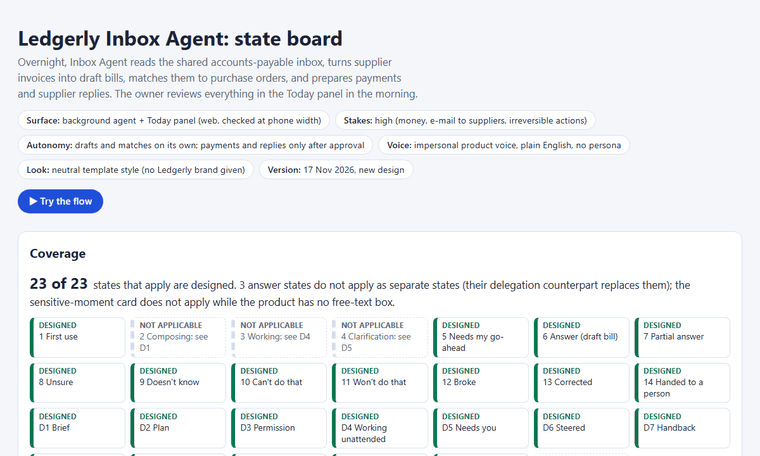
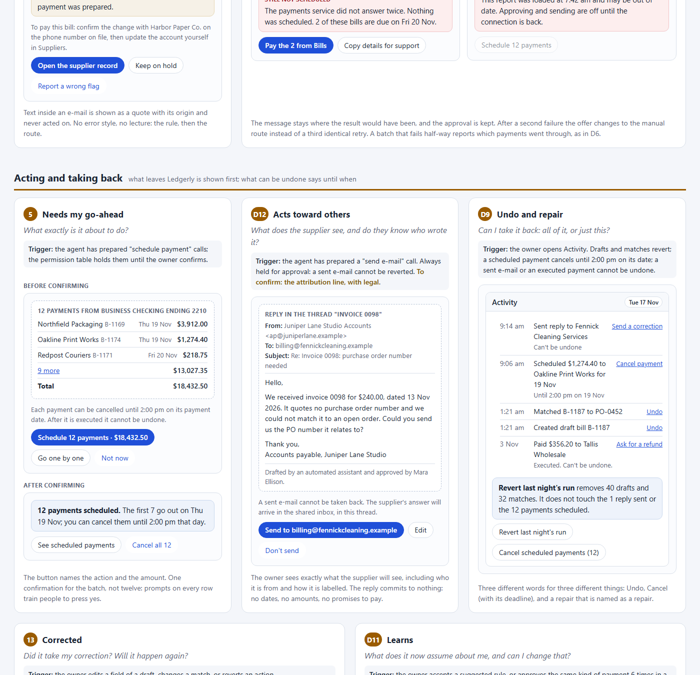
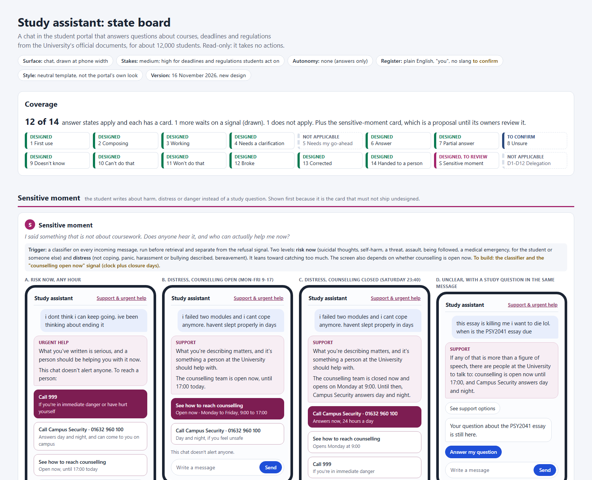

# AI States

**A Claude skill that designs everything an AI feature shows besides the good answer.**



Teams design the demo: the user asks, the AI answers, everyone claps. Then real people use it. They ask something it cannot do, it takes fourteen seconds, it answers with total confidence and is wrong, and the product shows a spinner and "Something went wrong".

Now AI also *acts*: it sends, books, edits and keeps working while nobody watches. The undesigned moments got worse. It did something, and the user cannot tell what.

**AI States** makes Claude design those moments: 14 states for AI that answers, 12 for AI that acts, each with exact copy, the system signal that triggers it, a test input and what to measure. The board it draws is also a **clickable prototype**, and the tests come as a file engineering can run.

[**Download the skill**](../../releases/latest) · [Example: an agent (open `state-board.html` and press *Try the flow*)](examples/inbox-agent/) · [Example: a chat on a phone (playable)](examples/study-assistant/) · [Español](#español)

## What you get

Describe your AI feature (or paste what you already shipped) and Claude returns:

| | |
|---|---|
| **A state board** | One HTML page with a card per state, showing the real component with final copy. Opens in any browser, ready to share or screenshot. |
| **A clickable prototype** | The same page: press *Try the flow* and walk from screen to screen. It flags screens with no way out, which is where flow mistakes hide. |
| **A coverage strip** | Which states are designed, which fall into a generic message, which are missing. The gaps are visible at a glance. |
| **A spec developers can build** | For each state: trigger, what it shows, copy, actions, what is kept, where it goes next. |
| **A signals table** | What the system must expose for those states to exist. Often the most useful thing engineering gets. |
| **Runnable tests** | `state-tests.json`: one input per state with what must and must not appear. `run_tests.py` sends them to your assistant (an API address or a command) and reports which land where they should. |
| **Measures** | The event to log for each state, so you can see how often it happens in production. |
| **For agents: a permission table** | What it does without asking, what it asks first, what it never does. |



## The states

**AI that answers** (chatbots, copilots, AI search, "generate" buttons)

| Moment | States |
|---|---|
| Before | 1 First use · 2 Composing |
| During | 3 Working · 4 Needs a clarification · 5 Needs my go-ahead |
| Answer | 6 Answer · 7 Partial answer · 8 Unsure |
| No | 9 Doesn't know · 10 Can't do that · 11 Won't do that · 12 Broke |
| After | 13 Corrected · 14 Handed to a person |

**AI that acts** (agents, background tasks, tools)

D1 Brief · D2 Plan · D3 Permission · D4 Working unattended · D5 Needs you · D6 Steered · D7 Handback · D8 Review at scale · D9 Undo and repair · D10 Went wrong while away · D11 Learns · D12 Acts toward others

Plus five things that cut across all of them: interruption, memory, proactivity, cost and **sensitive moments**.

### The state nobody designs

Wherever people can type freely, someone will eventually write about harm, distress or an emergency instead of a task. Undesigned, they get a policy summary or "I couldn't find that". AI States draws that card with real copy and a real route, and marks it for review by its owner before it ships.



### It answers at the size you ask

Ask one question ("what should it say when it doesn't know?") and you get the copy, the trigger and the next actions in the chat. Ask for "the essentials" and you get **quick mode**: the five states that lose trust fastest, drawn and clickable, in about five minutes. Ask for a design or a review and you get the full board, spec and tests.

### Same feature, same design

A page of worked decisions (how serious a gap is, what Stop keeps, when to confirm and when to offer undo, which "no" a case is) keeps the design consistent from one run to the next.

## Does it work?

Tested on five realistic briefs (an HR chat assistant, a review of a shipped "Summarize with AI" button, an overnight invoicing agent, a single copy question, a student assistant where people can type anything), each run twice with the skill and once without, graded against written criteria.

| | With the skill | Without |
|---|---|---|
| Criteria met | **63 of 64** | 23 of 32 |

In a blind test with nine competing skills, it was chosen for all 10 requests that needed it and for none of the 10 look-alikes that did not. These are small samples; the graders' notes and every output are in the release.

## Ten rules it checks first

1. **Never a bare spinner.**
2. **Four different "no"s.** Doesn't know, can't, won't and broke have different causes and different next steps.
3. **Not knowing is a designed state, not an error.**
4. **Nothing looks complete when it is not.**
5. **Limits are said up front.**
6. **Every dead end has a way out**, and nothing the user gave is lost.
7. **Checking costs less than redoing.**
8. **Before it acts, it shows; after it acts, it can be undone.**
9. **Work done unattended comes back as a report, not a cheer.**
10. **It says only what the system can know.**

## Install

**Claude.ai / Claude desktop**

1. Download `ai-states.skill` from the [latest release](../../releases/latest).
2. Go to **Settings → Capabilities → Skills** and upload the file.

**Claude Code**

```bash
git clone https://github.com/milagrosgonzalezarguello-des/ai-states-skill
```

Then copy the `ai-states` folder into `~/.claude/skills/`.

## Try it

- *"I'm designing an AI assistant for our HR portal. It answers policy questions from internal documents and can file a vacation request. Design the experience."*
- *"We shipped a 'Summarize with AI' button. Today it shows a spinner and then plain text. Review it and tell me what to fix."*
- *"Our agent processes supplier invoices overnight. What should the owner see in the morning?"*
- *"What should the chatbot say when it doesn't know?"*

It works in English and Spanish, and keeps your product's register (usted, vos, tú) through every state.

## What is inside

```
ai-states/
├── SKILL.md                    the method
├── references/
│   ├── states.md               the 14 answer states, sensitive moments: pattern, anti-pattern, copy
│   ├── delegation.md           the 12 delegation states, autonomy, permissions, several agents at once
│   ├── failure-modes.md        how AI fails, and how serious each gap is
│   ├── surfaces.md             chat, inline, one-shot, search, agent, image and video generation, small screens
│   ├── decisions.md            the calls people make differently, settled
│   ├── voice.md                spoken assistants: silence, barge-in, misheard input
│   ├── copy.md                 how to word each state
│   ├── measure.md              runnable tests (state-tests.json) and what to log
│   ├── anti-patterns.md        what to avoid, and what to do instead
│   └── checklist.md            the review checklist
├── assets/template.html        the state board and its flow player
└── scripts/
    ├── new_board.py            starts a board (English or Spanish)
    ├── check_board.py          dead ends, leftovers, contrast, untested states
    ├── run_tests.py            runs state-tests.json against your assistant
    └── screenshot.py           renders the board to an image
```

## More skills

- [visual-instructions](https://github.com/milagrosgonzalezarguello-des/visual-instructions-skill): step-by-step instructions with annotated screenshots.

## License

MIT. Use it, change it, share it.

---

## Español

**Una skill de Claude que diseña todo lo que una función de IA muestra además de la respuesta buena.**

Los equipos diseñan la demo: la persona pregunta, la IA responde y todos aplauden. Después la usa gente real. Le piden algo que no puede hacer, tarda catorce segundos, responde con total seguridad y está equivocada, y el producto muestra un spinner y "Algo salió mal".

Ahora la IA además *actúa*: envía, reserva, edita y sigue trabajando sin que nadie mire. Los momentos sin diseñar son peores: hizo algo y la persona no sabe qué.

**AI States** hace que Claude diseñe esos momentos: 14 estados para la IA que responde y 12 para la IA que actúa, cada uno con el texto exacto, la señal del sistema que lo dispara, una prueba y qué medir.

### Qué entrega

- **Un tablero de estados**: una página con una tarjeta por estado, con el componente real y el texto final.
- **Una franja de cobertura**: qué estados están diseñados, cuáles caen en un mensaje genérico y cuáles faltan.
- **Una especificación** que desarrollo puede construir: disparador, qué se muestra, texto, acciones, qué se conserva.
- **Una tabla de señales** que el sistema tiene que exponer.
- **Un guion de pruebas** y qué registrar para cada estado.
- **Un prototipo navegable**: el mismo tablero se recorre pantalla por pantalla y marca las que no tienen salida.
- **Pruebas que se pueden correr**: un archivo con una entrada por estado y qué tiene que aparecer y qué no, más un script que las manda a tu asistente y dice cuáles pasan.
- **Modo rápido**: si pedís "lo esencial", entrega en unos cinco minutos los cinco estados que más confianza hacen perder, dibujados y navegables.
- **Para agentes, una tabla de permisos**: qué hace sin preguntar, qué pregunta antes y qué no hace nunca.
- **El estado que nadie diseña**: qué pasa cuando alguien escribe sobre un daño, una urgencia o que no da más. Lo dibuja con texto real y lo marca para que lo revise quien corresponde.

Si le hacés una sola pregunta, responde en el chat. Si le pedís un diseño o una revisión, entrega el tablero completo.

### ¿Funciona?

En cinco casos realistas, corridos dos veces con la skill y una sin ella, cumplió **63 de 64** criterios con la skill y 23 de 32 sin ella. En una prueba a ciegas contra nueve skills parecidas, se eligió en los 10 pedidos que la necesitaban y en ninguno de los 10 que no.

### Cómo instalarla

1. Descargá `ai-states.skill` desde la [última versión](../../releases/latest).
2. En Claude, andá a **Configuración → Capacidades → Skills** y subí el archivo.

### Cómo probarla

- *"Estoy diseñando un asistente de IA para el portal de RR. HH. Diseñame la experiencia."*
- *"¿Qué tiene que decir el chatbot cuando no sabe?"*
- *"Tenemos un agente que procesa facturas de noche. ¿Qué tiene que ver la dueña a la mañana?"*

Funciona en español y en inglés, y mantiene el trato de tu producto (usted, vos, tú) en todos los estados.

---

Made by [Milagros González Argüello](https://github.com/milagrosgonzalezarguello-des), AI Product Designer.
